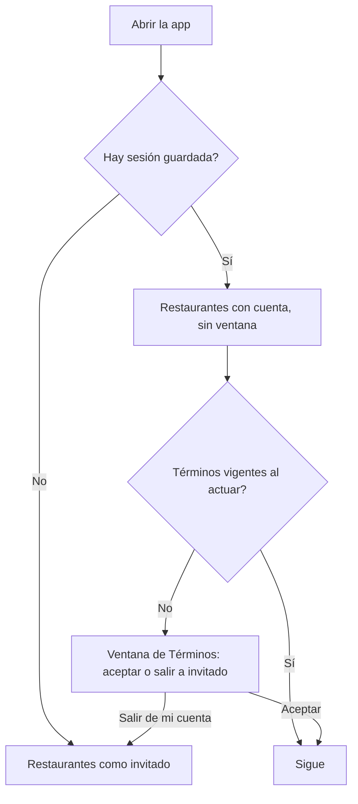
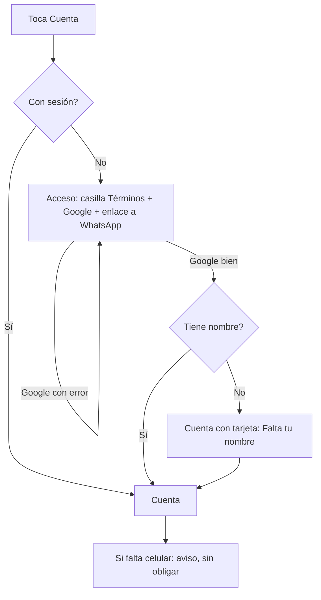
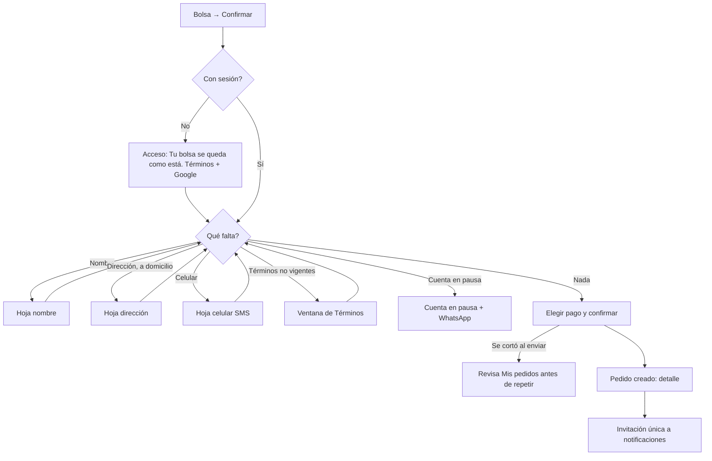
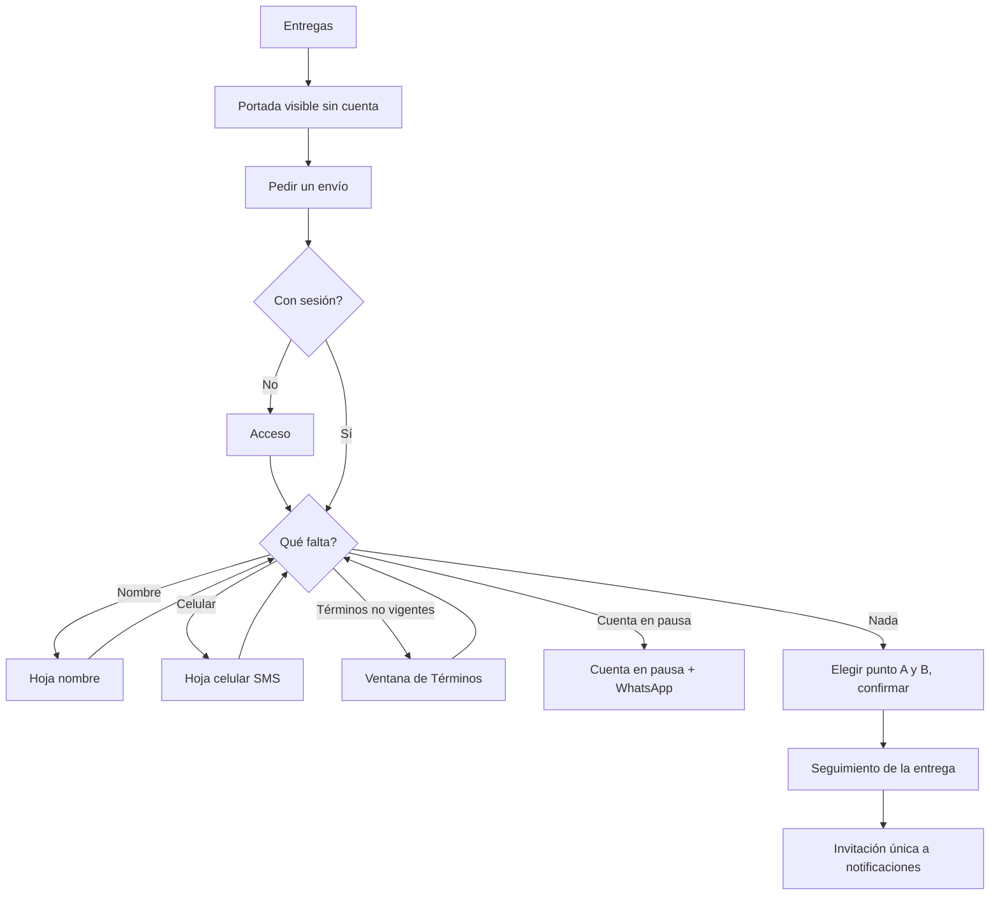
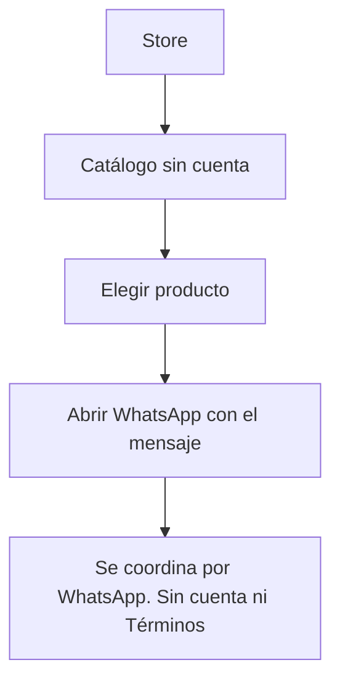
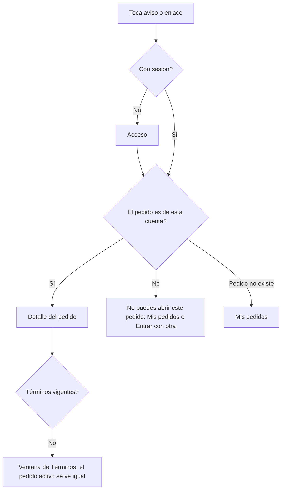
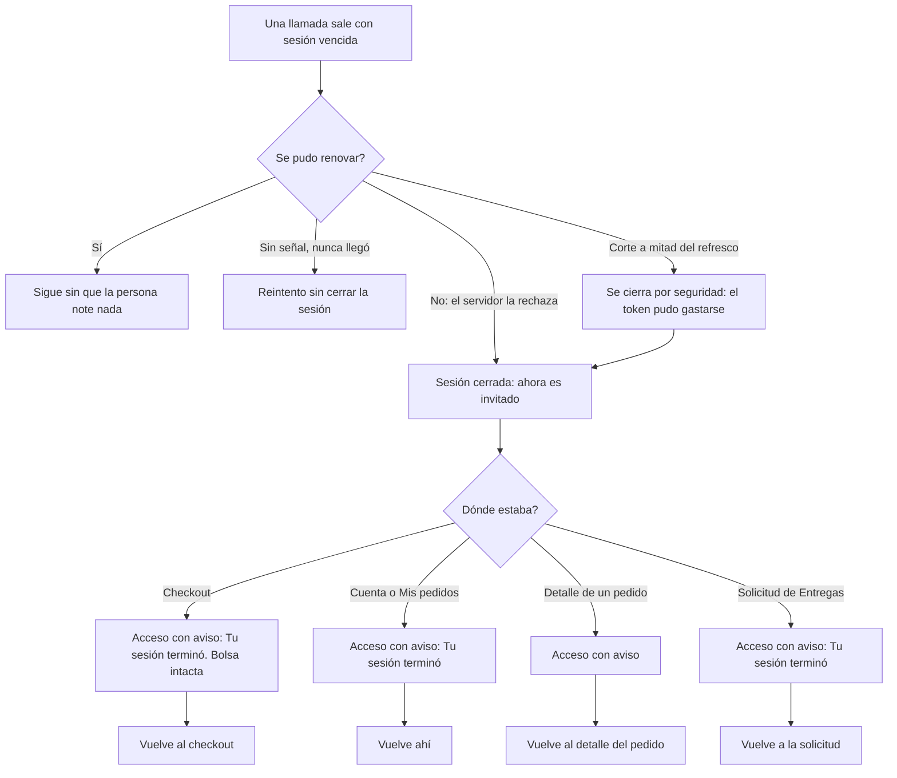

# Flujo · Acceso y datos del cliente

> **Decisiones de Jesús del 2026-11-17 que cierran preguntas de este flujo:** reaceptación de Términos **al actuar**, nunca al abrir ni sobre un pedido en curso o el soporte (CUS-AUT-027); casilla siempre, desmarcada, antes de Google (CUS-AUT-020); notificaciones opcionales, un solo interruptor «Avisos de tus pedidos» (CUS-NOT-005); celular de otra cuenta por soporte de WhatsApp, sin traslado automático (CUS-AUT-028); pedido ajeno: «No puedes abrir este pedido» con «Mis pedidos» y «Entrar con otra cuenta» (CUS-TRK-023). Donde este flujo diga «decisión actual de Jesús: ventana al abrir», «Recomendación (Jesús aún no decide)» o ofrezca el traslado «Usar en esta cuenta», manda esto.

> Origen: mapa v4 auditado por Codex y Hydrogen en 3 rondas (2026-11-17; expediente fuera del repo:
> `tindivo-auditorias/2026-11-16-ux-movil/v3/flujo-acceso/`). Las preguntas abiertas a Jesús están en
> `../decisiones-abiertas.md`; mientras no se decidan, lo marcado «propuesta» no es regla.

Es una **propuesta de diseño**, no una firma ni asesoría legal. Lo marcado «A VERIFICAR» no tiene certeza.
Base: `origin/develop` (lectura del código, 17-nov-2026) y las decisiones de Jesús del 16-nov.

## 0. Las 8 reglas del flujo

1. **Todo se ve sin cuenta:** restaurantes, carta, bolsa, Store y la portada de Entregas.
2. **La cuenta se pide al actuar:** confirmar un pedido, pedir una entrega, abrir Cuenta o «Mis pedidos». Nunca al abrir la app.
3. **Un solo orden de pendientes:** Acceso (Google + Términos) → nombre → dirección (solo domicilio) → celular verificado → pedir.
4. **Cada pendiente es una hoja dentro de la puerta por la que entró** y, al terminar, la persona sigue donde estaba, con la bolsa intacta. La única excepción es el Acceso: una pantalla que siempre vuelve exactamente al origen.
5. **Recomendación (Jesús aún no decide): nada se bloquea por notificaciones.** Se invitan una vez, tras el primer pedido.
6. **Un solo evaluador de pendientes:** antes de cada acción se mira qué falta (Términos, nombre, dirección, celular) y se repite tras cada hoja. Los estados pueden venir juntos.
7. **Una casilla, dos documentos:** «Acepto los Términos y he leído la Política de privacidad», dos enlaces, versión de cada uno registrada por separado. No autoriza promociones ni usos futuros (A VERIFICAR con abogado, Ley 29733).
8. **La casilla sale siempre en el Acceso** (alternativa A); el registro es idempotente: quien ya aceptó esa versión solo marca otra vez. La alternativa B (Google primero y aceptar después) queda como pregunta abierta.

## 1. Qué exige cada puerta

| Puerta | Términos | Nombre | Dirección | Celular verificado | Cuenta |
|---|---|---|---|---|---|
| P1 Abrir la app | no | no | no | no | no |
| P2 Cuenta → Entrar | sí (en el Acceso) | no se exige; tarjeta «Falta tu nombre» que abre la hoja | no | no se exige; se avisa «Falta verificar» | sí |
| P3 Confirmar desde la bolsa | sí | sí | solo a domicilio | sí | sí |
| P4 Entregas: pedir un envío | sí | sí | no (elige puntos A y B) | sí | sí; cuenta en pausa no pide |
| P5 Store | no | no | no | no | no (solo WhatsApp) |
| P6 Enlace o notificación a un pedido | sí | no | no | no | sí, y la cuenta dueña del pedido |
| P7 Sesión vencida | se vuelve a pedir Entrar | — | — | — | sí |

## 2. Estado de la persona × puerta (qué ve, en qué orden)

«Hoja» = ventana dentro de la pantalla, sin salir de ella. «Acceso» = pantalla de entrada (casilla de Términos + Google).

| Estado | P1 Abrir | P2 Cuenta → Entrar | P3 Bolsa → Confirmar | P4 Entregas | P5 Store | P6 Abrir un pedido |
|---|---|---|---|---|---|---|
| **Invitado** | Ve restaurantes. No se le pide nada. | Acceso → vuelve a Cuenta (tarjeta de nombre si falta). | Acceso directo (con la línea «Tu bolsa se queda como está») → vuelve al checkout → hojas de lo que falte. | Ve la portada; «Pedir» → Acceso → vuelve a la solicitud. | Catálogo y WhatsApp, igual. | Acceso → abre ese pedido (si es suyo). |
| **Con cuenta, Términos no vigentes** (cuenta antigua o versión nueva) | **Propuesta:** navega sin ventana (solo mira). Decisión actual de Jesús: ventana obligatoria al abrir. | La ventana sale antes de abrir Cuenta. | **Propuesta:** la ventana sale aquí, al actuar (decisión de Jesús: «al cambiar»; ver conclusión). | Igual. | Nada. | Igual, salvo un pedido activo: se ve sin ventana. |
| **Sin nombre** (cuenta nueva) | Nada. | Entra; tarjeta «Falta tu nombre» (opcional aquí). | Hoja de nombre. | Hoja de nombre. | Nada. | Puede ver sus pedidos (consultar no exige nombre). |
| **Sin celular verificado** | Nada. | Entra; «Falta verificar tu teléfono». | Hoja de celular (SMS). | Hoja de celular (SMS). | Nada. | Puede ver sus pedidos (si el celular se trasladó a otra cuenta, el pedido sigue siendo suyo). |
| **Sin dirección** | Nada. | Nada. | A domicilio: hoja de dirección. **Recojo: no se pide.** | No aplica: A y B se eligen en la solicitud. | Nada. | Nada. |
| **Cuenta en pausa** (incidentes) | Restaurantes. | Ve su cuenta. | «Cuenta en pausa» + WhatsApp; no pide. | Igual. | Nada. | Ve sus pedidos. |
| **Completo** | Restaurantes. | Ve su cuenta. | «Confirmar pedido · total». | «Pedir entrega». | Igual. | Abre el pedido. |

### Combinaciones imposibles o que no se muestran
- **Invitado con Términos pendientes:** sin cuenta no hay a qué vincular la aceptación.
- **Cuenta nueva sin Términos:** existe un instante (Google bien, registro fallido): es un estado pendiente que impide pedir y se reintenta; no se sigue sin él.
- **Pedir sin nombre:** pedir exige nombre; consultar pedidos antiguos, no.
- **Dirección en Entregas o Store:** no usan la libreta de direcciones.
- **Sesión vencida siendo invitado:** no hay sesión que vencer.

## 3. Fallos: qué ve, adónde vuelve, qué conserva

| Fallo | Qué ve la persona | Adónde vuelve | Qué conserva |
|---|---|---|---|
| Google cancelado | Nada: el Acceso queda como estaba. | Al Acceso (puede reintentar o «Volver»). | Bolsa y lo escrito. |
| Google con error | «No se pudo entrar. Inténtalo otra vez.» | Al Acceso. | Bolsa. |
| Casilla de Términos sin marcar | El botón de Google sigue activo; al tocarlo se resalta la casilla («Marca la casilla para entrar»). | Al Acceso. | Bolsa. |
| Google sin cuenta en el teléfono | «Agrega una cuenta de Google en Ajustes.» | Al Acceso. | Bolsa. |
| Play Services viejo o ausente | «Actualiza Google Play para entrar.» (la salida depende del fallo detectado) | Al Acceso. | Bolsa. |
| Google bien pero falla guardar la aceptación | «No pudimos guardar. Reintenta.» No se sigue sin ella; si se cierra la app, la cuenta queda como «Términos no vigentes». | Al Acceso. | Bolsa. |
| El SMS no llega | «Cambiar número» siempre activo; «Reenviar» tras 60 s. Reiniciar la app no reinicia la espera ni el cupo (lo manda el servidor). | A la misma hoja. | Número escrito. |
| Código mal o vencido | «Escribe el código de 6 dígitos» / «Pasó demasiado tiempo. Pide uno nuevo.» | A la misma hoja. | Número. |
| Demasiados intentos de SMS | Texto del servidor + «Escribir por WhatsApp». | Hoja de celular. | Bolsa. |
| **Celular ya es de otra cuenta, con traslado permitido** | «Este número está en otra cuenta. Si lo usas aquí, la otra pierde la verificación y recibe un aviso.» → «Usar en esta cuenta» o «Cancelar». | A la hoja (Cancelar) o al checkout con el celular verificado. | Bolsa; no se mueven pedidos ni datos. |
| **Celular de otra cuenta, sin traslado** | Texto del servidor. Se añade «Escribir por WhatsApp» y «Probar otro número». | Hoja de celular. | Bolsa. Soporte verifica el celular (decisión de Jesús). |
| Dirección fuera de zona | «Fuera de la zona de reparto en San Jacinto»; no deja guardar. | Al mapa para mover el punto. | Bolsa; otras direcciones. |
| Sin señal a mitad | «Revisa tu conexión» con reintento; la hoja no se cierra. | A la misma hoja o pantalla. | Bolsa (vive en el aparato) y lo escrito. |
| Permiso de notificaciones denegado | Nada bloquea. En el pedido: franja «Notificaciones desactivadas» + «Abrir Ajustes». | Al pedido. | Todo. |
| Se cortó la conexión justo al confirmar | «No sabemos si tu pedido anterior llegó. Revisa Mis pedidos» (ya existe; el pedido lleva clave de idempotencia y la app la consulta antes de repetir: `OrderAttemptLedger.kt:23-112`). En Entregas, A VERIFICAR que sea igual. | Al checkout. | Bolsa. |
| Negocio cerró, producto agotado o cambió el total | Aviso en el checkout; nada se crea. | Al checkout. | Bolsa editable. |
| Punto A o B de Entregas fuera de zona, o ubicación/GPS negado | Mover el pin a mano (la zona se valida al crear). | A la solicitud. | Borrador de la solicitud. |
| Se cerró la app o el sistema la mató a mitad | Vuelve al inicio; la bolsa sigue. El número y el código SMS **no** se guardan a propósito (seguridad). | Al inicio. | Bolsa. |
| WhatsApp no abre (Store) | «Copiar mensaje» y el número. | A Store. | Producto elegido. |
| Sesión vencida | «Tu sesión terminó» + Acceso (igual en checkout, Entregas, Cuenta y Mis pedidos). | Al mismo lugar tras entrar. | Bolsa; el borrador de Entregas, A VERIFICAR (hoy solo consta la bolsa en el aparato). |

## 4. Un diagrama por puerta

### P1 — Abrir la app (propuesta «al actuar». La decisión vigente de Jesús es «ventana obligatoria al abrir»: ver pregunta a)

### P2 — Cuenta → Entrar

### P3 — Confirmar desde la bolsa

### P4 — Entregas

### P5 — Store

### P6 — Enlace o notificación que abre un pedido (hoy no existe en Android: sin deep links ni FCM)

### P7 — Sesión vencida

## 5. Hechos del código que sostienen el mapa (origin/develop)

Rutas: `apps/android/customer/src/main/kotlin/com/tindivo/customer/...`
- **No hay onboarding:** `navigation/AppNavHost.kt:104` (`startDestination = CatalogHomeRoute`). Cuenta sin sesión → `SignInRoute` (`AppNavHost.kt:122-124`).
- **Acceso sin Términos:** `feature/signin/SignInScreen.kt:65-91` solo título y botón Google. Cancelar vuelve a `Idle` y fallar a `Failed` (`SignInViewModel.kt:59-63`). Cuenta con perfil: `Done` → `onBack()` (`SignInScreen.kt:45`); sin perfil (404): `NeedsProfile` → pantalla completa de nombre que reemplaza al Acceso (`AppNavHost.kt:169-171`).
- **Los Términos solo se registran en el guardado del nombre:** `feature/profile/ProfileViewModel.kt:124` (`acceptTerms(TERMS_VERSION)` y luego `saveName`), versión fija `"2026-05"` (`ProfileName.kt:8`). Una cuenta con perfil ya creado nunca pasa por ahí: **no hay reaceptación**.
- **Checkout:** orden de lo que falta nombre → dirección → celular → pago (`feature/checkout/CheckoutUiState.kt:184-209`); hojas en `CheckoutUiState.kt:106-147` y `CheckoutSheets.kt:69-85`. Sin sesión: «Entra para pedir… Tu bolsa se queda como está» (`strings.xml:323-325`); al cerrarse la sesión conserva las líneas de la bolsa (`CheckoutViewModel.kt:120-140`).
- **Celular:** reenvío cada 60 s (`feature/phone/PhoneVerifyViewModel.kt:36`); 409 con oferta de traslado → diálogo (`:346`); 409 sin oferta, 429 y 422 → texto del servidor (`:392-407`); textos del traslado en `strings.xml` `phone_transfer_*`.
- **Entregas:** pedir exige sesión (`feature/courier/CourierRequestViewModel.kt:64-66`, `CourierRequestScreen.kt:135-151`); hoja de celular (`CourierRequestForm.kt:102`); navegación en `navigation/CourierNavigation.kt:30-48`; la portada muestra «Iniciar sesión» sin sesión (`CourierHomeScreen.kt:164`).
- **Store:** `feature/store/*` no consulta la sesión (sin referencias en la carpeta) y solo arma el WhatsApp (`StoreWhatsapp.kt`).
- **Sesión vencida:** si el refresco falla por algo distinto de «nunca llegó a Auth», la sesión se cierra (`session/SupabaseSessionStore.kt:165-181`, `drop()` en `:210-214`). Cuenta, Mis pedidos y Detalle solo vuelven atrás **sin mensaje** (`AccountScreen.kt:69`, `OrdersScreen.kt:55`, `OrderDetailScreen.kt:50`).
- **Avisos y enlaces:** el manifiesto solo tiene `INTERNET` y ubicación, y un único intent-filter LAUNCHER (`AndroidManifest.xml`); no hay `POST_NOTIFICATIONS`, FCM ni deep links.
- **Dirección fuera de zona:** `AddressFormViewModel.kt:74` (`canSave` exige `missing == null`); textos `strings.xml:141,156`.

## 6. Cambios que este mapa pide al código (para el canvas y para el desarrollo)
1. Casilla de Términos y Política en el Acceso; registrar versión y fecha apenas haya cuenta.
2. Ventana de reaceptación (hoy no existe). Jesús decidió «al abrir»; ambos auditores recomiendan «al actuar». Con cualquiera de las dos: ayuda, privacidad y borrado siguen accesibles, y un pedido activo se ve sin aceptar.
3. Que el Acceso siempre vuelva a quien lo llamó y que el nombre sea hoja en todas las puertas (hoy es pantalla completa desde Cuenta y Entregas).
4. Aviso «Tu sesión terminó» con vuelta al mismo lugar. Hoy el refresco cierra la sesión si el corte llega después de enviar el token (`SupabaseSessionStore.kt:160-182`: puede estar gastado); distinguir un corte previo es posible, uno a mitad no. A VERIFICAR con el desarrollador (ventana de reuso del token de Supabase). Mitigación: una sola renovación a la vez y no reintentar ciegamente un token posiblemente gastado.
5. Invitación a notificaciones tras el primer pedido («¿Activar notificaciones de tus pedidos y promociones de Tindivo?» / «Sí, activar» · «Ahora no»), franja de «desactivadas» y en Cuenta «Estados del pedido» y, aparte, «Promociones» (recomendación de ambos auditores; Jesús decide, A VERIFICAR Ley 29733).
6. Entrada por enlace o aviso al pedido (nueva), con «No puedes abrir este pedido» (sin confirmar de quién es).
7. Enlace «¿Problemas para entrar?» a WhatsApp en el Acceso; el botón de Google nunca se apaga.
8. «Escribir por WhatsApp» y «Probar otro número» cuando el celular es de otra cuenta sin traslado.
